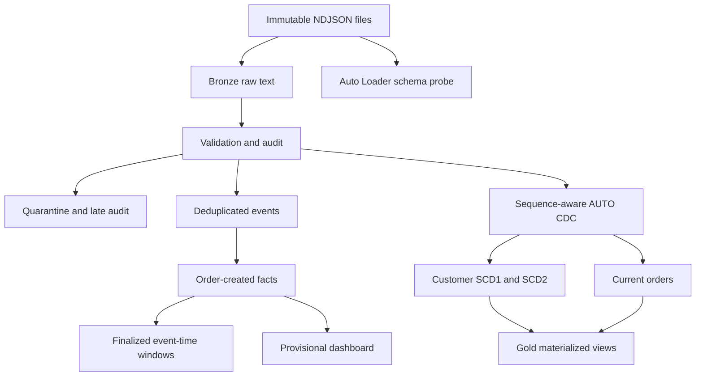

# Retail streaming lakehouse

Deployable Databricks portfolio implementation of complex NDJSON → Auto Loader → Bronze → quality checks → Silver → AUTO CDC / SCD1 / SCD2 → Gold. Runtime-specific acceptance remains a deployment gate; local tests do not certify Databricks execution or production capacity.

## 1. Architecture overview

Immutable source files are the replay log. Raw text preserves source payloads, including malformed JSON. A parallel JSON schema probe captures Auto Loader rescued fields. Validated rows split into quarantine, an event-time deduplicated analytics stream, and an unwatermarked sequence-aware CDC stream. Mutable current-state tables feed materialized business views; immutable creation facts feed finalized streaming windows.

## 2. Architecture diagram



## 3. Business scenario

Retail orders have multiple items, payments and shipments; customers have multiple addresses. CDC updates contain full after-images and deletes contain the business key in the before-image. Sequence numbers are monotonic per entity/key; timestamps are expected to follow the same business ordering. ORDER_CANCELLED is an UPDATE with status CANCELLED. ORDER_DELETED is a physical current-state deletion. Payments and shipments are append-only event logs; they are not added again to order revenue.

Revenue is order merchandise value, excludes tax/refunds and cancelled/deleted orders in current-state Gold. It is not a recognized accounting revenue measure. Gold is grouped by currency; Customer 360 has one row per customer/currency. A customer with no orders has a null currency and zero totals. Category average order value means category-attributed merchandise revenue divided by distinct orders in that category; category order counts are not additive.

## 4. Sample complex JSON

`sample_data/scenarios.json` contains 18 NDJSON lines, including one deliberately malformed line, two duplicates, five invalid records, late data, versions 1–3, cancellation, payment/shipment and customer CDC. Generate fresh timestamps with `python scripts/generate.py --output local_landing/orders`.

A representative after-image is:

```json
{"event_id":"evt-1-ORDER_CREATED","event_type":"ORDER_CREATED","event_timestamp":"2026-09-06T10:00:00Z","cdc":{"entity":"order","operation":"INSERT","sequence_number":1,"before":null,"after":{"order":{"order_id":"ORD000001","order_status":"CONFIRMED","currency":"INR","created_at":"2026-09-06T10:00:00Z","items":[{"product_id":"P100","product_name":"Laptop","category":"Electronics","quantity":"2","unit_price":75000}]}}}}
```

This excerpt illustrates CDC shape; the complete fixtures also contain mandatory customer/source/metadata fields.

## 5. Project structure

| Path | Purpose |
|---|---|
| `src/pipeline.py` | Declarative table and flow registrations |
| `src/retail/` | Schemas, configuration, pure Spark validation/transforms |
| `resources/`, `databricks.yml` | Pipeline, jobs and deployment targets |
| `scripts/` | Bootstrap, generator, replay, CDF consumer, acceptance |
| `tests/` | Unit, medallion integration and real streaming recovery tests |
| `sample_data/` | Deterministic failure/evolution/CDC fixtures |
| `sql/` | Permissions, business assertions and monitoring queries |
| `docs/` | Operational contracts, CI/CD and validation evidence |

## 6. Unity Catalog design

Separate catalogs `retail_dev`, `retail_test`, `retail_prod`; each has bronze, silver, gold and dq schemas. Managed volumes `bronze.landing` and `bronze.pipeline_state` hold source files and the diagnostic schema registry. Managed pipeline tables have pipeline-managed storage/checkpoints. An external volume may replace landing after a platform administrator creates a storage credential and external location with managed identity. Never store access keys in bundle YAML. Runtime identity owns pipeline outputs; producer can write landing; BI sees approved Gold views only. Raw/quarantine and Customer 360 contain PII and require governed access, retention and masking policies.

## 7. Bronze implementation

`raw_events` is append-only and reads `cloudFiles.format=text`, one JSON document per UTF-8 line. It stores raw_payload, ingestion and processing times, file path/modification time and extracted envelope fields. Text excludes line separators but does not reconstruct JSON. Pretty-printed multiline JSON is outside the source contract and will be quarantined line by line. Binary fidelity, if needed, requires a separate binary archive.

`schema_probe` independently reads JSON using schemaLocation, schema hints, rescue evolution and `_rescued_data`. It is diagnostic, not a join source. Raw `rescued_data` denotes unparseable raw payload; probe `_rescued_data` is the actual Auto Loader unknown-field/type rescue. These have intentionally different meanings. This extra scan trades ingestion cost for both raw fidelity and schema-drift visibility.

Bronze does not deduplicate business events: that would destroy the evidence needed to explain retransmission and recovery. Auto Loader file tracking prevents re-reading the same immutable file during ordinary restart.

## 8. Data quality implementation

`validation_rules()` defines event, customer, CDC, order, item, currency and payment rules. Numbers arrive as strings and are checked with try_cast; malformed types never crash ANSI-mode casts. Validation is event-wide: one invalid item quarantines the entire event. Null predicate results are failures. Expectations report violations without dropping rows; `invalid_events` stores the original payload, reasons and source file. `validated_events` retains both paths and supports reconciliation.

Investigate using `sql/validation.sql`. Export selected quarantine rows, correct their source contract, and use `scripts/replay.py`. It creates a fresh event ID plus metadata.replay_of and preserves business event time. CDC corrections require an approved newer source sequence. Replay of very old analytics facts needs a controlled backfill into a separate recomputed target; a new ID does not bypass a watermark. Never replay valid order creations with new IDs casually: that can double-count business facts.

## 9. Silver implementation

Current customers/orders are AUTO CDC streaming tables. Customer addresses and current order items are materialized views over mutable snapshots so removal of an address/item does not leave stale children. `events`, `order_created_facts`, `order_item_events`, `payments`, `shipments` are append-only streaming datasets.

from_json supplies the nested contract. posexplode gives item/address position within a snapshot; positions are not stable business line IDs across order edits. explode is appropriate when no index is needed; explode_outer retains an empty parent with a null child, unsuitable for item revenue counting. Higher-order forall validates arrays without exploding. Item and address arrays are never exploded together. A HOME address is selected with filter/try_element_at rather than assuming address index zero.

## 10. CDC implementation

`dp.create_auto_cdc_flow` handles source INSERT/UPDATE/DELETE and out-of-order arrival. Sequence ordering is `(sequence_number, event_timestamp, event_id, payload_hash)` for deterministic conflict resolution. Same sequence with differing payloads appears in `dq.cdc_conflicts`; alert and reconcile with source owner. The lexical tie-breaker ensures convergence, not business correctness of contradictory source events. Exact duplicate inputs share the same ordering tuple. Customer/order updates must be full after-images; explicit null clears a field (`ignore_null_updates=False`). Supporting sparse patches requires a distinct presence-aware contract.

CDC bypasses event-time dedup to avoid losing old dimension updates. Seven-day tombstone retention assumes at most seven days of delayed CDC plus outages; increase it beyond the real source delay before production. Source sequence/timestamp consistency is a producer contract. If sequence and timestamp disagree, sequence wins and displayed effective timestamps may not be monotonic; investigate before using history as a temporal join dimension.

Delta CDF is the downstream change log of Delta mutations, not the upstream business CDC envelope. Enabled on current tables, it includes `_change_type`, `_commit_version`, `_commit_timestamp`. `scripts/cdf_consumer.py` preserves all change types in a separate audit table. A current-state consumer must apply deletes and update postimages, not sum both update images. Starting version must still be retained. AUTO CDC avoids custom foreachBatch MERGE sequencing and tombstone code; MERGE is appropriate for a separately orchestrated imperative sink that needs custom transactional logic.

## 11. SCD Type 1

`silver.customers` has the latest row per customer. Fixtures create C001 in Bengaluru, deliver Hyderabad at sequence 105, retransmit it, deliver older Mumbai at 102, then delete at 110. The final current table has no C001. Orders use the same pattern and cancellation is a status update rather than deletion.

## 12. SCD Type 2

`silver.customer_history` tracks customer versions with AUTO CDC `__START_AT`/`__END_AT` ordering structs. `gold.customer_history` exposes effective timestamps, is_current, source_event_timestamp and ordinal record_version. C001 should have three closed historical versions after deletion. Deletes close history rather than create a visible DELETE version; the delete event remains in customer_changes. The ordinal can change when older history arrives; it is a display version, not a stable surrogate key. Use the full __START_AT struct for exact ordering/tie boundaries.

## 13. Gold implementation

Customer 360 joins current customers to current noncancelled order totals. Sales summary is date/hour/region/category/currency. Product performance includes units, revenue and distinct customers. These are materialized views, allowing updates/deletes to propagate. Refund/return accounting and exchange-rate conversion require additional contracts before financial reporting.

## 14. Streaming aggregation

Tumbling: 10 minutes. Sliding: 30 minutes every 5 minutes, up to six windows per event. Session: customer/currency with a 10-minute inactivity gap. All aggregate one row per deduplicated order creation, so item arrays do not inflate order count. Quantity is computed across each order's items before aggregation. Streaming tables emit finalized windows in append semantics once watermark permits; session windows can merge while open. `streaming_dashboard` is a provisional materialized aggregation and refreshes with pipeline updates for fresher BI consumption. It is explicitly not cancellation-adjusted; use sales_summary for current totals.

## 15. Watermark and late data design

30 minutes assumes online event arrival SLA of 30 minutes, to be validated from delay percentiles before production. Event time is source occurrence; ingestion time is observed processing arrival. Spark advances a watermark based on observed event time, not wall-clock age; idle streams may not finalize windows. Rows older than the watermark can be discarded by stateful analytics operators. Future timestamps beyond five minutes of ingestion are quarantined so a corrupt future event cannot arbitrarily advance state.

`dropDuplicatesWithinWatermark([event_id])` bounds state by event-time progress (Spark 3.5+). Plain dropDuplicates(event_id) can retain unbounded state; dropDuplicates(event_id,event_timestamp) makes timestamp part of identity. Dedupe is bounded, not a forever uniqueness guarantee. Retransmissions must keep event_id and event_timestamp immutable. Long-horizon uniqueness and recovery use raw retention plus batch reconciliation. `late_events` reports arrival SLA violations, not the exact engine dropped-row count. Engine state metrics in the event log are authoritative for watermark drops. DQ audit and CDC preserve rows before analytics stateful operators.

## 16. Checkpoint design

Lakeflow owns pipeline checkpoints; do not start writeStream inside a decorated definition or pass a fake checkpoint option to readStream. Pipeline identity and flow names must remain stable across deploys. The schema probe has a stable per-environment registry in a UC Volume. The optional external CDF consumer explicitly uses a unique checkpoint such as `/Volumes/retail_prod/bronze/pipeline_state/cdf_orders_v1`.

Offsets/file discovery, commit information and state-store data let a failed cluster resume committed progress. Transactional Delta sinks plus stable source/checkpoint identity support exactly-once processing of source positions, not arbitrary end-to-end business deduplication. Never delete state manually. A state schema change may require a new flow and isolated backfill rather than reusing incompatible checkpoints. Full refresh must be planned with complete source retention and downstream CDF consumers in mind.

## 17. Schema evolution

Versions 1, 2 (loyalty_tier), 3 (marketing_preferences) share an explicit nullable contract. New approved fields are added through code review. Unsupported versions quarantine until the contract is updated; raw data remains available. The probe uses `rescue` so unexpected fields do not silently change business tables. An alternative addNewColumns mode updates schema then stops on new columns, requiring a restart; do not combine it with an explicit full input schema. Type widening is runtime-dependent and intentionally not relied on here. Nested unknown fields always remain in raw_payload, even if the fixed parser ignores them.

## 18. Performance optimization

Serverless and Photon are configured. Avoid partitioning tiny tables or high-cardinality customer/order keys. Profile table size, predicate selectivity and platform support before enabling liquid clustering on order/customer IDs; do not combine legacy partitioning with liquid clustering. Let managed pipeline compaction manage small files; use OPTIMIZE only according to platform-managed table support and observed file stats.

The 30-second trigger trades freshness against scheduling cost. Tune maximum files and watermark using backlog/state metrics. Sliding windows multiply state; session skew can concentrate large customers. Pre-aggregation avoids item-level order-count shuffles. Do not salt keys without a second-stage exact reconciliation design. Batch dimension joins may use automatic broadcast when small; never force broadcast of unbounded customer data. Full-history duplicate audits and Gold views can become expensive at scale: measure incremental refresh plans, introduce date-bounded operational views plus scheduled full reconciliation where justified. No throughput claim is made without a representative load test.

## 19. Observability

DQ tables expose processed/rejected counts, arrival delay, late-by-SLA, duplicate copies, CDC operation counts and conflicts. Published `dq.pipeline_event_log` provides flow progress, failures and runtime rate/state metrics. `sql/validation.sql` keeps raw event details because nested metric field availability differs by runtime. Wire SQL alerts for nonzero conflicts, rejection rate >1% over your agreed window, growing backlog and failed updates; route to an approved incident channel. DQ arrival delay is not processing latency. Measure processing latency/update duration, input/output rate, watermark drops and state size from runtime logs; do not substitute zeros for unavailable metrics.

## 20. Testing

```bash
python -m pip install -e '.[test]'
python -m pytest -q
python -m ruff check .
```

Local Spark tests exercise JSON/numeric parsing, five quarantine scenarios, schema evolution, array cardinality, CDC source preparation, Gold arithmetic and a real file stream across checkpointed restarts, duplicates and late data. Databricks engine-only AUTO CDC, Auto Loader, expectations and managed materialized views require `scripts/acceptance.py` in an isolated test catalog. Run the pipeline once, run acceptance, restart without changing landing files, then run acceptance again. Local tests deliberately do not pretend to execute Databricks services.

## 21. Sample data generator

```bash
python scripts/generate.py --output local_landing/orders --batches 1
python scripts/generate.py --output /Volumes/retail_dev/bronze/landing/orders --batches 0 --interval 5
```

The second command runs on Databricks compute with volume write access. Each immutable NDJSON file is completed outside the watched directory then moved in. Single-writer fixture sequencing is deterministic; synthetic continued batches use time-based keys. This is a load/example producer, not a replacement for source-database log sequence numbers. Fixture customer deletion and order cancellation are deliberate.

## 22. Databricks Asset Bundle

`databricks.yml` defines dev/test/prod and includes pipeline/job resources. Uses current Lakeflow `pyspark.pipelines`, `@dp.table`, `@dp.materialized_view`, `@dp.expect_all`, `create_streaming_table`, `create_auto_cdc_flow`. AUTO CDC and expectations are Databricks additions, not guaranteed in open-source Spark. New default publishing mode with `schema` and fully qualified names is required; legacy LIVE-mode pipelines need migration. Advanced/serverless availability depends on workspace/cloud/entitlement. Validate the bundle against the workspace's supported CLI schema before deploy. Production is continuous; dev/test are triggered. Host and credentials come from CLI profile/environment, not source code.

## 23. CI/CD

Repository workflows run Python/Spark tests and lint on pull requests. A separate manually triggered deployment workflow uses a protected GitHub Environment per target, OAuth service-principal credentials from environment secrets, bundle validation and deploy. Configure mandatory reviewers for prod in GitHub settings; YAML alone cannot enforce approval. The deployment workflow validates/tests again before deployment. DEV → isolated TEST + runtime acceptance → approved PROD is the release policy; no untested commit should be promoted. See docs/operations.md for rollback and gates.

## 24. Deployment instructions

1. Install a current Databricks CLI and authenticate to your actual workspace (`databricks auth login --host https://<workspace-host>`). For CI use OAuth M2M credentials from protected environment secrets.
2. Import/run scripts/bootstrap.py with the chosen catalog; grant runtime/producer permissions using sql/security.sql.
3. Generate a fresh sample batch locally. Upload its completed files using `databricks fs cp --recursive local_landing/orders dbfs:/Volumes/retail_dev/bronze/landing/orders`.
4. From this project directory run `databricks bundle validate -t dev --var service_principal=<application-id>` then `databricks bundle deploy -t dev --var service_principal=<application-id>`.
5. Start a triggered update with `databricks bundle run -t dev refresh --var service_principal=<application-id>`.
6. Query Bronze/DQ/Silver/Gold with sql/validation.sql; wait for all flows to complete. Final streaming windows may be absent until later event-time data advances the watermark.
7. Repeat in a clean retail_test catalog using only one scenarios batch; run `databricks bundle run -t test acceptance --var service_principal=<application-id>`. Restart refresh and run acceptance again.
8. Promote the identical reviewed commit to prod after runtime, security and load gates. Deploy prod then start its pipeline update from the Pipelines UI or `databricks pipelines start-update <pipeline-id>`. Do not schedule overlapping triggered refresh jobs for the continuous prod pipeline.

The provided Jobs acceptance notebook requires a workspace supporting serverless notebook tasks; attach an approved job cluster if unsupported. This environment has no Databricks workspace credentials, so deployment and Databricks acceptance are not claimed as executed.

## 25. Validation SQL

See sql/validation.sql and scripts/acceptance.py for executable queries/assertions. Isolated fixture expectations: raw 18, quarantine 5, C001 absent from current customers, three closed history versions, ORD000001 cancelled, no current items for that order, old order ORD000006 still reaches CDC. Late analytics counts may depend on microbatch ordering and are not hard-coded.

## 26. Troubleshooting guide

| Symptom | Action |
|---|---|
| No raw rows | Check UC READ VOLUME, complete immutable files, source path and pipeline event log |
| All records quarantined | Inspect rejection_reasons, event version and complete CDC after-images |
| No finalized windows | Check watermark/event-time progress; use provisional dashboard |
| Stale deleted customer | Inspect source sequence, before key and tombstone horizon |
| Conflicting CDC | Investigate dq.cdc_conflicts; publish source-authorized higher sequence correction |
| Restart fails on state | Restore compatible code; migrate/backfill a new flow, never delete checkpoints casually |
| CDF starting version missing | Re-snapshot and establish a new checkpoint/version boundary |
| Bundle schema/API error | Validate CLI/workspace support for current publishing and AUTO CDC |

## 27. Senior-level interview explanation

I preserve a lossless business audit trail before quality filtering. Analytics deduplication is bounded by event-time SLA, while source-ordered CDC is independent so late updates do not silently corrupt current state. I distinguish mutable business totals from immutable event metrics and use materialized views for corrections. I keep array grains separate, group money by currency, and treat runtime acceptance, permissions, recovery and measured capacity as release requirements rather than asserting that valid Python is production certification.

## 28. Interview questions and answers

1. Why raw text Bronze? It preserves malformed payloads and exact JSON text for replay; a parsed diagnostic source handles schema rescue separately.
2. Why no watermark on CDC? Old business updates still need sequence-aware processing, especially historical dimensions.
3. Why AUTO CDC rather than foreachBatch MERGE? It supplies ordered change application and SCD history; custom MERGE requires implementing and testing those semantics.
4. Does exactly-once mean no duplicates? No. File/transaction progress and business event identity are separate concerns.
5. Why materialized child tables? Current snapshots replace arrays; append-only explosion would leave removed items/addresses behind.
6. What closes a streaming window? Event-time watermark progress, not the wall clock alone.
7. How are duplicates older than retention handled? Keep raw evidence and reconcile/backfill; bounded streaming state is not a permanent identity store.
8. Is CDF the same as source CDC? No. CDF records Delta mutations; source CDC expresses business changes and source ordering.
9. Why track currency? Summing amounts from different currencies creates meaningless totals without governed conversion rates.
10. How do you deploy a state-breaking change? Use an isolated target/backfill and reconciliation before cutover; preserve old checkpoints for rollback.
11. What is the primary schema-evolution risk? Silently accepting incompatible business meaning, even when a parser can coerce the type.
12. How would Kafka fit? Replace Bronze source with Kafka key/value/topic/partition/offset ingestion; retain the same downstream event contract and source-position audit.

## 29. Production readiness checklist

- [ ] Workspace validates current bundle schema, publishing mode, serverless and Advanced features.
- [ ] Isolated Databricks fixture and restart acceptance passes.
- [ ] Source ordering, timestamp consistency, event identity and full-image contracts are enforced upstream.
- [ ] Measured lateness/outage SLA fits watermark and tombstone retention.
- [ ] Representative throughput, skew, state growth and cost tests pass.
- [ ] UC permissions, PII retention/masking and service-principal ownership are reviewed.
- [ ] Conflict/rejection/backlog alerts and on-call ownership are configured.
- [ ] Raw/CDF retention, restore procedure and backfill reconciliation are rehearsed.
- [ ] Protected deployment environments require production approval.
- [ ] Workspace host, identities and environment variables are supplied securely.

### Verified API references

Official documentation consulted for current API choices:
- [Lakeflow Python API](https://docs.databricks.com/aws/en/ldp/developer/python-ref)
- [AUTO CDC function and sequencing](https://docs.databricks.com/aws/en/ldp/developer/ldp-python-ref-apply-changes)
- [Auto Loader schema and rescue modes](https://docs.databricks.com/aws/en/ingestion/cloud-object-storage/auto-loader/schema)
- [Default publishing mode](https://docs.databricks.com/aws/en/ldp/migrate-to-dpm)
- [Bundle resources](https://docs.databricks.com/aws/en/dev-tools/bundles/resources)

The code avoids preview bitemporal/type-widening features. Revalidate workspace-specific behavior before production deployment.
